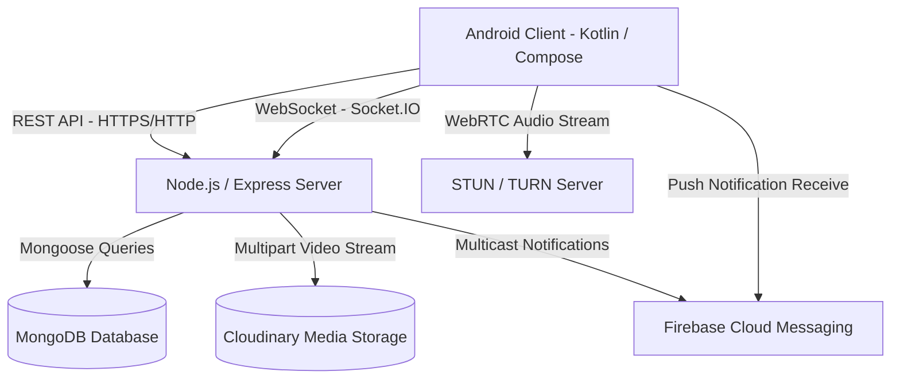

# Socio - Full Project & Backend Integration Specification

## 1. Executive Summary & Architecture Overview

**Socio** is a developer-centric social video-sharing, real-time messaging, and audio-calling application featuring an obsidian dark and electric yellow design system.

The system architecture consists of a native Android client communicating with a centralized Node.js/Express backend service backed by:
- **MongoDB (Mongoose)** for persistent user, video, chat history, and call log metadata.
- **Cloudinary** for video streaming asset storage and transformations.
- **Socket.IO** for bidirectional real-time messaging, online presence indicators, and WebRTC audio call signaling.
- **Firebase Cloud Messaging (FCM)** for background push notifications (new messages, incoming calls, video likes).
- **WebRTC / TURN Server** for encrypted low-latency peer-to-peer audio calls.



---

## 2. Database Models & Schema Definitions (MongoDB / Mongoose)

### 2.1 `User` Schema
```javascript
const mongoose = require('mongoose');

const userSchema = new mongoose.Schema({
    name: { 
        type: String, 
        required: true,
        trim: true 
    },
    username: { 
        type: String, 
        required: true, 
        unique: true, 
        trim: true,
        lowercase: true,
        index: true 
    },
    email: { 
        type: String, 
        required: true, 
        unique: true, 
        trim: true,
        lowercase: true,
        index: true 
    },
    password: { 
        type: String, 
        required: function() { return !this.googleId; }, // Optional if authenticated via Google
        select: false 
    },
    googleId: { 
        type: String, 
        default: null,
        index: true 
    },
    avatarUrl: { 
        type: String, 
        default: null 
    },
    followers: [{ 
        type: mongoose.Schema.Types.ObjectId, 
        ref: 'User' 
    }],
    following: [{ 
        type: mongoose.Schema.Types.ObjectId, 
        ref: 'User' 
    }],
    fcmTokens: { 
        type: [String], 
        default: [] 
    },
    isOnline: { 
        type: Boolean, 
        default: false 
    },
    lastSeen: { 
        type: Date, 
        default: Date.now 
    }
}, { timestamps: true });

module.exports = mongoose.model('User', userSchema);
```

---

### 2.2 `Video` Schema
```javascript
const videoSchema = new mongoose.Schema({
    url: { 
        type: String, 
        required: true 
    },
    publicId: { 
        type: String, 
        required: true,
        unique: true,
        index: true 
    },
    title: { 
        type: String, 
        required: true,
        trim: true 
    },
    description: { 
        type: String, 
        default: "" 
    },
    uploaderId: { 
        type: mongoose.Schema.Types.ObjectId, 
        ref: 'User', 
        required: true 
    },
    uploaderUsername: { 
        type: String, 
        required: true 
    },
    uploaderAvatar: { 
        type: String, 
        default: null 
    },
    category: { 
        type: String, 
        enum: ['for_you', 'following', 'live'], 
        default: 'for_you' 
    },
    whoCanWatch: { 
        type: String, 
        enum: ['public', 'followers', 'private'], 
        default: 'public' 
    },
    views: { 
        type: Number, 
        default: 0 
    },
    likesCount: { 
        type: Number, 
        default: 0 
    }
}, { timestamps: true });

module.exports = mongoose.model('Video', videoSchema);
```

---

### 2.3 `Message` Schema (Chat History & Call Logs)
```javascript
const messageSchema = new mongoose.Schema({
    senderId: { 
        type: mongoose.Schema.Types.ObjectId, 
        ref: 'User', 
        required: true 
    },
    senderUsername: { 
        type: String, 
        required: true,
        index: true 
    },
    recipientId: { 
        type: mongoose.Schema.Types.ObjectId, 
        ref: 'User', 
        required: true 
    },
    recipientUsername: { 
        type: String, 
        required: true,
        index: true 
    },
    text: { 
        type: String, 
        required: true 
    },
    type: { 
        type: String, 
        enum: ['text', 'call', 'media'], 
        default: 'text' 
    },
    callDuration: { 
        type: String, // e.g. "12:41"
        default: null 
    },
    mediaUrl: { 
        type: String, 
        default: null 
    },
    read: { 
        type: Boolean, 
        default: false 
    }
}, { timestamps: true });

module.exports = mongoose.model('Message', messageSchema);
```

---

## 3. Complete REST API Endpoint Specifications

All authenticated endpoints require the header:
```
Authorization: Bearer <JWT_TOKEN>
```

### 3.1 Authentication & User Management

#### `GET /` - Token Verification
- **Purpose**: Called on app startup during Splash Screen to validate session.
- **Headers**: `Authorization: Bearer <token>`
- **Response (200 OK)**:
  ```json
  {
    "success": true,
    "message": "Valid Token",
    "user": {
      "id": "674f1b8a9c2d1234567890ab",
      "username": "mira.r",
      "name": "Mira Ray"
    }
  }
  ```
- **Error Response (401 Unauthorized)**:
  ```json
  {
    "success": false,
    "message": "Invalid or expired token"
  }
  ```

---

#### `GET /users/check-username` - Live Username Availability Check
- **Purpose**: Provides real-time feedback on registration screen (`@mira.r is available`).
- **Query Parameter**: `?username=<desired_username>`
- **Response (200 OK)**:
  ```json
  {
    "success": true,
    "username": "mira.r",
    "available": true
  }
  ```
- **Response if taken (200 OK)**:
  ```json
  {
    "success": true,
    "username": "mira.r",
    "available": false
  }
  ```

---

#### `POST /register` - User Registration
- **Purpose**: Creates a new user account from the registration screen.
- **Body (`application/json`)**:
  ```json
  {
    "email": "you@domain.dev",
    "username": "mira.r",
    "name": "Mira Ray",
    "password": "securepassword123"
  }
  ```
- **Response (201 Created)**:
  ```json
  {
    "success": true,
    "message": "User created successfully",
    "user": {
      "id": "674f1b8a9c2d1234567890ab",
      "username": "mira.r",
      "email": "you@domain.dev",
      "name": "Mira Ray"
    }
  }
  ```
- **Failure (409 Conflict / Validation Error)**:
  ```json
  {
    "success": false,
    "message": "Username or email is already registered"
  }
  ```

---

#### `POST /login` - User Login
- **Purpose**: Authenticates user via username or email and password.
- **Body (`application/json`)**:
  ```json
  {
    "username": "mira.r",
    "password": "securepassword123"
  }
  ```
- **Response (200 OK)**:
  ```json
  {
    "success": true,
    "message": "Login successful",
    "token": "eyJhbGciOiJIUzI1NiIsInR5cCI6IkpXVCJ9...",
    "user": {
      "id": "674f1b8a9c2d1234567890ab",
      "username": "mira.r",
      "name": "Mira Ray"
    }
  }
  ```
- **Failure (401 Unauthorized)**:
  ```json
  {
    "success": false,
    "message": "Invalid username or password"
  }
  ```

---

#### `POST /auth/google` - Google OAuth Sign-in
- **Purpose**: Verifies Google ID Token sent from Android client and logs in or registers user.
- **Body (`application/json`)**:
  ```json
  {
    "idToken": "eyJhbGciOiJSUzI1NiIsImtpZCI6..."
  }
  ```
- **Backend Flow**:
  1. Verify token using `google-auth-library` (`oauth2Client.verifyIdToken(...)`).
  2. Extract `email`, `name`, `sub` (Google ID), `picture`.
  3. Find or create user. If new, generate username from email.
  4. Issue Socio JWT.
- **Response (200 OK)**:
  ```json
  {
    "success": true,
    "message": "Google authentication successful",
    "token": "eyJhbGciOiJIUzI1Ni...",
    "user": {
      "id": "674f1b8a9c2d1234567890ab",
      "username": "mira.r",
      "name": "Mira Ray"
    }
  }
  ```

---

#### `DELETE /logout` - User Logout
- **Headers**: `Authorization: Bearer <token>`
- **Response (200 OK)**:
  ```json
  {
    "success": true,
    "message": "Logout successful"
  }
  ```

---

#### `GET /users` - Get Users Directory (For Chat)
- **Headers**: `Authorization: Bearer <token>`
- **Query Parameters**:
  - `?search=<query>` (optional)
- **Response (200 OK)**:
  ```json
  [
    {
      "_id": "674f1b8a9c2d1234567890ab",
      "name": "Mira Ray",
      "username": "mira.r",
      "avatarUrl": null,
      "isOnline": true
    },
    {
      "_id": "674f1b8a9c2d1234567890cd",
      "name": "Null Pointer",
      "username": "nullpointer",
      "avatarUrl": null,
      "isOnline": false
    }
  ]
  ```

---

### 3.2 Video Feed & Upload Management

#### `GET /videos` - Fetch Video Feed
- **Headers**: `Authorization: Bearer <token>`
- **Query Parameters**:
  - `category`: `for_you` | `following` | `live` (defaults to `for_you`)
  - `page`: Integer (defaults to 1)
  - `limit`: Integer (defaults to 10)
- **Response (200 OK)**:
  ```json
  [
    {
      "_id": "674f208b9c2d1234567890cd",
      "title": "Rewriting 14 commits live, and nothing broke",
      "description": "Live coding session re-architecting git history.",
      "publicId": "socio_videos/xyz123",
      "url": "https://res.cloudinary.com/demo/video/upload/v123456789/socio_videos/xyz123.mp4",
      "uploaderId": "674f1b8a9c2d1234567890cd",
      "uploaderUsername": "nullpointer",
      "category": "for_you",
      "whoCanWatch": "public",
      "views": 48200,
      "createdAt": "2026-10-16T14:30:00.000Z"
    }
  ]
  ```

---

#### `POST /videos` - Upload New Video ("New video" Screen)
- **Headers**: `Authorization: Bearer <token>`, `Content-Type: multipart/form-data`
- **Form Data Parts**:
  - `video`: Binary video stream (e.g. `upload.mp4`)
  - `title`: String ("What is this video about?")
  - `description`: String ("Add details, links, timestamps")
  - `whoCanWatch`: String (`public` | `followers` | `private`) (defaults to `public`)
  - `category`: String (`for_you` | `following` | `live`) (defaults to `for_you`)
- **Backend Flow**:
  1. Multer receives file in memory or temporary disk storage.
  2. Stream upload to Cloudinary with `resource_type: "video"`.
  3. Extract `public_id` and secure streaming `url`.
  4. Create `Video` record in MongoDB linked to authenticated user `uploaderId: req.user.id`.
- **Response (201 Created)**:
  ```json
  {
    "success": true,
    "message": "Video Uploaded Successfully",
    "video": {
      "publicId": "socio_videos/v_9827341",
      "url": "https://res.cloudinary.com/..."
    }
  }
  ```

---

#### `DELETE /videos` - Delete Video
- **Headers**: `Authorization: Bearer <token>`
- **Query Parameter**: `?publicId=<CLOUDINARY_PUBLIC_ID>`
- **Authorization Check**: Must verify `video.uploaderId.toString() === req.user.id`.
- **Response (200 OK)**:
  ```json
  {
    "success": true,
    "message": "Video Deleted Successfully"
  }
  ```
- **Failure (403 Forbidden)**:
  ```json
  {
    "success": false,
    "message": "You are not authorized to delete this video"
  }
  ```

---

#### `POST /videos/:publicId/view` - Increment View Count
- **Headers**: `Authorization: Bearer <token>`
- **Response (200 OK)**:
  ```json
  {
    "success": true,
    "views": 48201
  }
  ```

---

### 3.3 Persistent Chat History & Messages

#### `GET /messages` - Fetch Chat Conversation History
- **Headers**: `Authorization: Bearer <token>`
- **Query Parameters**:
  - `withUser=<username>` (Required, e.g. `withUser=mira.r`)
  - `limit`: Integer (default: 50)
  - `before`: ISO Timestamp or message ID (for pagination)
- **Response (200 OK)**:
  ```json
  [
    {
      "_id": "674f30129c2d1234567890ef",
      "senderUsername": "mira.r",
      "recipientUsername": "awais",
      "text": "did you see the oncall stream? latency was nuts",
      "type": "text",
      "read": true,
      "createdAt": "2026-10-19T10:15:00.000Z"
    },
    {
      "_id": "674f30139c2d1234567890f0",
      "senderUsername": "awais",
      "recipientUsername": "mira.r",
      "text": "yes, turn server was the culprit",
      "type": "text",
      "read": true,
      "createdAt": "2026-10-19T10:16:00.000Z"
    },
    {
      "_id": "674f30149c2d1234567890f1",
      "senderUsername": "mira.r",
      "recipientUsername": "awais",
      "text": "Audio call · 12:41",
      "type": "call",
      "callDuration": "12:41",
      "read": true,
      "createdAt": "2026-10-19T10:17:00.000Z"
    }
  ]
  ```

---

### 3.4 Push Notifications (Firebase Cloud Messaging)

#### `POST /registerNotification` - Register FCM Device Token
- **Headers**: `Authorization: Bearer <token>`
- **Body (`application/json`)**:
  ```json
  {
    "username": "mira.r",
    "fcmtoken": "dGhpcy1pcy1hbi1mY20tdG9rZW4..."
  }
  ```
- **Response (200 OK)**:
  ```json
  {
    "success": true,
    "message": "FCM token inserted successfully"
  }
  ```

---

#### `POST /notification` - Send Notification to User
- **Headers**: `Authorization: Bearer <token>`
- **Query Parameter**: `?username=<RECIPIENT_USERNAME>`
- **Body (`application/json`)**:
  ```json
  {
    "title": "New message from @mira.r",
    "body": "did you see the oncall stream? latency was nuts",
    "data": {
      "type": "chat",
      "fromUsername": "mira.r"
    }
  }
  ```
- **Response (200 OK)**:
  ```json
  {
    "success": true,
    "message": "Notification sent"
  }
  ```

---

### 3.5 WebRTC & Audio Call Signaling

#### `GET /calls/turn-credentials` - STUN/TURN ICE Server Credentials
- **Purpose**: Generates dynamic ephemeral TURN credentials (via Twilio, Metered.ca, or Coturn) for real-time encrypted peer-to-peer audio calls.
- **Headers**: `Authorization: Bearer <token>`
- **Response (200 OK)**:
  ```json
  {
    "iceServers": [
      {
        "urls": "stun:stun.l.google.com:19302"
      },
      {
        "urls": "turn:turn.socio.dev:3478",
        "username": "ephemeral_user_token",
        "credential": "ephemeral_password"
      }
    ]
  }
  ```

---

## 4. Socket.IO Real-Time Architecture (Chat & Audio Calls)

### 4.1 Connection & Handshake Authentication
Client connects with:
```javascript
const socket = io(BASE_URL, {
    auth: { token: "<JWT_TOKEN>" }
});
```

Server middleware verifies the token and binds user information to the socket:
```javascript
io.use(async (socket, next) => {
    try {
        const token = socket.handshake.auth.token;
        if (!token) return next(new Error("Authentication token required"));
        
        const decoded = jwt.verify(token, process.env.JWT_SECRET);
        socket.user = decoded; // { id, username }
        next();
    } catch (err) {
        return next(new Error("Invalid token"));
    }
});
```

---

### 4.2 Real-Time Event Dictionary

| Event Name | Direction | Payload | Description |
|---|---|---|---|
| `connection` | Server | Socket initialized | Marks user as `isOnline: true` in DB and notifies contacts. |
| `disconnect` | Server | Socket terminated | Cleans up user socket map and marks `isOnline: false`. |
| `user_presence` | Server -> Clients | `{ username, isOnline: true/false }` | Emitted to broadcast contact availability. |
| `chat message` | Client -> Server | `{ toUserName: "mira.r", message: "latency was nuts" }` | Saves message to MongoDB and forwards to recipient. |
| `chat message` | Server -> Client | `{ from: "mira.r", message: "latency was nuts", timestamp, id }` | Emitted to recipient device. |
| `call:initiate` | Client -> Server | `{ toUserName: "mira.r", callType: "audio" }` | Caller requests audio call session. |
| `call:incoming` | Server -> Client | `{ fromUserName: "awais", callType: "audio", callId }` | Forwarded to target recipient. |
| `call:answer` | Client -> Server | `{ toUserName: "awais", accepted: true/false, callId }` | Target recipient accepts/declines call. |
| `call:ice-candidate`| Bidirectional | `{ toUserName, candidate }` | Relays WebRTC ICE candidate packets. |
| `call:end` | Client -> Server | `{ toUserName, duration: "12:41" }` | Terminates call and logs call badge in `Message` collection. |

---

### 4.3 Multi-Device & Socket Management Pattern
Replace single `userSocketMap[userId] = socketId` with a Set to allow seamless multi-tab or multi-device connections:

```javascript
// Map: username -> Set of socket IDs
const userSockets = new Map();

io.on('connection', (socket) => {
    const username = socket.user.username;
    
    if (!userSockets.has(username)) {
        userSockets.set(username, new Set());
    }
    userSockets.get(username).add(socket.id);
    
    // Broadcast user is online
    io.emit('user_presence', { username, isOnline: true });

    socket.on('disconnect', () => {
        const sockets = userSockets.get(username);
        if (sockets) {
            sockets.delete(socket.id);
            if (sockets.size === 0) {
                userSockets.delete(username);
                io.emit('user_presence', { username, isOnline: false });
            }
        }
    });

    // Chat Message Handler
    socket.on('chat message', async ({ toUserName, message }) => {
        // 1. Save to MongoDB
        const savedMessage = await Message.create({
            senderId: socket.user.id,
            senderUsername: username,
            recipientUsername: toUserName,
            text: message,
            type: 'text'
        });

        // 2. Deliver via Socket.IO if recipient is online
        const recipientSockets = userSockets.get(toUserName);
        if (recipientSockets && recipientSockets.size > 0) {
            recipientSockets.forEach(sockId => {
                io.to(sockId).emit('chat message', {
                    id: savedMessage._id,
                    from: username,
                    message: message,
                    timestamp: savedMessage.createdAt
                });
            });
        } else {
            // 3. Fallback: Trigger FCM Push Notification
            sendPushNotification(toUserName, {
                title: `@${username}`,
                body: message,
                data: { from: username, type: 'chat' }
            });
        }
    });
});
```

---

## 5. Environment Variables Template (`.env.example`)

```env
# Application Port & Environment
PORT=3000
NODE_ENV=development

# Database (MongoDB)
MONGODB_URI=mongodb+srv://<username>:<password>@cluster0.mongodb.net/socio?retryWrites=true&w=majority

# JWT Authentication
JWT_SECRET=super_secret_jwt_signing_key_socio_2026
JWT_EXPIRES_IN=30d

# Cloudinary Media Storage (Videos & Thumbnails)
CLOUDINARY_CLOUD_NAME=your_cloudinary_cloud_name
CLOUDINARY_API_KEY=your_cloudinary_api_key
CLOUDINARY_API_SECRET=your_cloudinary_api_secret

# Firebase Admin SDK (Push Notifications)
FIREBASE_SERVICE_ACCOUNT_PATH=./firebase-service-account.json

# WebRTC STUN / TURN Server Credentials
TURN_SERVER_URL=turn:turn.socio.dev:3478
TURN_SERVER_USERNAME=socio_turn_user
TURN_SERVER_CREDENTIAL=socio_turn_password

# Google OAuth Client ID (For Google Sign-In)
GOOGLE_CLIENT_ID=your_google_oauth_client_id.apps.googleusercontent.com
```

---

## 6. Implementation Checklist for Backend Developer

- [ ] **1. Authentication**:
  - [ ] Add `email` field to `User` schema with unique index.
  - [ ] Implement `GET /users/check-username?username=...` for instant UI feedback.
  - [ ] Implement `POST /auth/google` with Google Auth Library token verification.
- [ ] **2. Video Management**:
  - [ ] Support `whoCanWatch` (`public`, `followers`, `private`) in video upload.
  - [ ] Support `category` (`for_you`, `following`, `live`) query parameter in `GET /videos`.
  - [ ] Enforce ownership check (`uploaderId === req.user.id`) in `DELETE /videos`.
  - [ ] Implement `POST /videos/:publicId/view` to increment view count.
- [ ] **3. Persistent Chat & Call History**:
  - [ ] Implement `Message` collection in MongoDB.
  - [ ] Create `GET /messages?withUser=<username>` endpoint.
  - [ ] Save call completion events as messages (`type: 'call'`, `callDuration: '12:41'`).
- [ ] **4. WebSockets & Audio Calls**:
  - [ ] Update Socket.IO user connection map to support multiple sockets per user (`Set<string>`).
  - [ ] Implement WebRTC signaling events (`call:initiate`, `call:incoming`, `call:answer`, `call:ice-candidate`, `call:end`).
  - [ ] Emit `user_presence` on connect/disconnect.
- [ ] **5. Hardening & Performance**:
  - [ ] Use standard HTTP status codes (`400`, `401`, `403`, `404`, `500`) instead of returning `200 OK` with `{ success: false }`.
  - [ ] Add rate limiting (`express-rate-limit`) on `/login` and `/register`.
